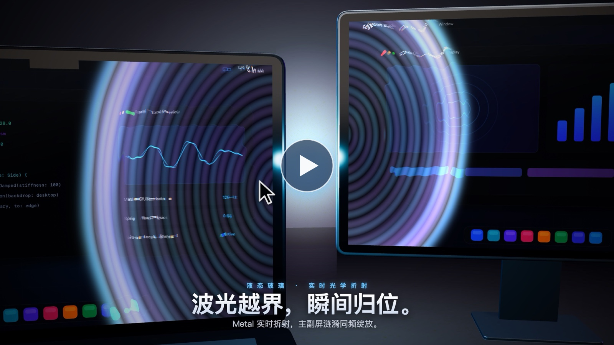

# EdgeShift

<p align="center">
  <a href="https://github.com/Drew131382/EdgeShift/releases/download/v0.1.9/EdgeShift-Promo-CN-1080p60.mp4">
    
  </a>
</p>
<p align="center">
  <a href="https://github.com/Drew131382/EdgeShift/releases/download/v0.1.9/EdgeShift-Promo-CN-1080p60.mp4">
    
  </a>
  &nbsp;
  <a href="https://github.com/Drew131382/EdgeShift/releases/download/v0.1.9/EdgeShift-Promo-1080p60.mp4">
    
  </a>
</p>
<p align="center">
  <a href="https://github.com/drew131382-create/EdgeShift/releases/download/v0.1.9/EdgeShift-0.1.9-experimental.dmg">
    
  </a>
  &nbsp; <a href="https://github.com/drew131382-create/EdgeShift/releases/tag/v0.1.9">查看 Release 说明</a>
</p>
<p align="center"><sub>Apple Silicon（arm64）· macOS 13 或更新版本</sub></p>

EdgeShift 是一个适用于 macOS 的多屏菜单栏应用（实验性原型）。当系统排列与实际摆放不一致时，可在主屏不可跨越的边缘持续向外推动鼠标，让副屏移动到对应方向；也可在菜单栏手动拖动排列。

## 功能

- 上、下、左、右四个方向的边缘推动检测；自动和快捷排列时，副屏沿相接边居中。
- 多屏示意图拖动排列及四个方向的快捷按钮；自动排列不主动更改系统主屏。
- 在菜单中选择“主显示器”，其余独立屏幕作为副屏。切换主屏时保持各屏幕的相对位置，排列图用顶部标记和“主屏”标签显示当前主屏。
- 在菜单中按副屏选择“扩展 / 复制”，支持扩展与复制混合使用。复制显示当前主屏内容，切回扩展后由 macOS 恢复排列；复制屏幕仍保留在选择器中，并显示复制来源。
- 自动排列开关、可调整的触发时长和登录启动开关。持续推动可选 0.3、0.5、0.7、1、2、3 秒，默认 2 秒；输入间隔超过 200 毫秒会重置，成功后冷却 3 秒。
- 边缘推动时显示液态玻璃波面，成功重排后从当前波面继续向内扩散。支持四个方向、独立动画开关及菜单内“预览”；预览只播放效果，不调整显示器排列。
- 自动暂停保护：默认在前台应用全屏时暂停；支持指定应用名单，仅在名单中的应用位于前台时暂停。可勾选“保留边缘”，被保留的边缘不再累计推动触发，其余方向照常。手动拖动和四方向快捷按钮继续可用。
- 排列功能需要主屏之外至少一块独立扩展屏；主屏可以是内建屏或外接屏。复制屏幕不参与排列，其他扩展屏继续可用。多屏时，每次自动触发按系统枚举顺序轮流调整一块扩展副屏，屏幕连接状态或复制关系变化时重新开始；系统枚举顺序可能在重新连接后改变。
- 目标方向已有屏幕时，目标副屏会接在已有屏幕外侧；如果移动会造成重叠或使布局断开，则提示并取消。手动拖动可以贴合其他屏幕，快捷按钮操作菜单中选定的副屏。

EdgeShift 从用户输入推断意图，不测量显示器的物理位置。推到当前指针位置已能跨到任何显示器的边缘不会重排；在角落以该事件向外位移较大的方向为准。屏幕编号是应用当前系统枚举顺序的标识，不保证与系统设置中的标识一致。

## 使用与权限

从本仓库的 Releases 下载实验性 DMG，打开后把 EdgeShift 拖入“应用程序”，再启动并在菜单栏点击 EdgeShift 图标。当前测试包为 Apple Silicon（arm64）版本，支持 macOS 13 或更新版本；Intel 版本尚未提供。

测试包使用临时签名，尚未经 Apple 公证。macOS 可能阻止首次打开；如果用户确认下载来源可信，可以在尝试打开后进入“系统设置 → 隐私与安全性”，在 EdgeShift 的提示处选择“仍要打开”并按系统提示确认。具体选项可能因系统版本或设备管理策略而不同，参见 [Apple 的安全打开应用说明](https://support.apple.com/zh-cn/102445)。更新临时签名版本后可能需要再次执行这些步骤或重新授权。

自动排列需要**输入监控**权限，以监听鼠标移动方向；手动排列和扩展 / 复制切换不需要该权限。应用启动时会请求授权；如果仍未获授权，会尝试打开“系统设置 → 隐私与安全性 → 输入监控”。系统可能不再显示授权提示，需要用户在设置中手动开启并按系统要求重启应用。“仍要打开”和输入监控授权是两项独立操作。

水波的实时桌面折射需要额外的**屏幕录制**权限，可在菜单内点击“去授权”。未授权或捕获不可用时仍显示柔和的玻璃高光。已授权时，仅在波面显示期间使用 ScreenCaptureKit 获取无鼠标的桌面帧供 GPU 折射，排除 EdgeShift 自身窗口，效果结束后停止捕获；不录制音频、不保存或上传画面。开启系统“减少动态效果”后改用局部高光淡入淡出，不进行桌面捕获和折射。

点击菜单面板之外的区域或切换到其他应用时，面板自动收起。面板内的时间选择、下拉菜单等控件继续正常操作。

在菜单上方选择副屏，再使用“扩展 / 复制”切换其模式；只有一块副屏时会直接显示名称。切换仅修改选中副屏，期间暂停排列并等待系统确认结果，失败或未确认时会显示原因。所有副屏都在复制时，可以继续从菜单切回扩展。若某块副屏正作为其他屏幕的复制源，需先逐块将这些屏幕切回扩展，才能将该副屏改为复制。应用启动时读取系统当前模式，不主动恢复应用偏好，也不主动调整分辨率或刷新率。

使用“主显示器”选择独立扩展屏作为主屏，原主屏随即成为副屏。复制屏需先切回扩展，才会出现在主屏候选中。切换通过整体平移桌面坐标保持屏幕之间的相对位置，不主动改写已有复制来源；后续新建复制关系会使用当前主屏。系统确认切换后才更新菜单，切换期间暂停自动和手动排列；若系统同时调整了排列，会显示提示。在系统设置中更改主屏或插拔屏幕，也会同步到菜单。主屏选择不需要输入监控权限。菜单内容较多时可滚动查看。

EdgeShift 在启动时默认尝试注册登录启动，可在菜单栏中关闭。系统可能要求用户在登录项中批准。

**目前没有经过 Developer ID 签名和 Apple 公证的正式发布包。** 从开发构建得到的应用不应被当作官方正式发行版。

## 自动暂停保护

在菜单栏打开“自动暂停设置…”：

- “前台应用全屏时暂停”默认开启。前台应用的可见、非完全透明窗口覆盖任一完整显示器时暂停，支持系统全屏和无边框全屏窗口；退出全屏或切换到普通窗口应用后恢复。
- 在“指定应用内暂停”中添加 `.app`，可随时移除。名单默认为空，按 Bundle ID 保存，应用正常更新后继续生效；后台运行或最小化的名单应用不会单独导致暂停。
- 在“保留边缘”中勾选的边缘（上、下、左、右）不再参与推动累计，也不会触发重排；用于把某条边缘留给通用控制等系统的边缘手势，其余方向继续可用。被保留的边缘会在应用中保存。
- 菜单会显示暂停原因。进入暂停、切换前台应用或 Space、修改保护设置时，推动进度清零；恢复后必须重新完成一次持续推动。打开 EdgeShift 自己的菜单或设置窗口不会解除之前的保护。

全屏识别使用 Core Graphics 窗口的进程、边界和透明度信息，按逻辑坐标判断，允许 2 点边缘误差；不读取标题、截图或窗口内容，不新增辅助功能或屏幕录制授权请求。如果系统无法返回有效窗口信息且全屏保护已开启，会暂时暂停并显示原因，查询恢复后重新判断。

这是按窗口覆盖范围判断的保护，并非游戏识别：自动隐藏菜单栏和 Dock 后，普通窗口若占满整块屏幕，也会被视为全屏。可关闭全屏保护并改用应用名单。特殊指针捕获、远程控制及不同游戏仍需实机验证；未提供通用控制自动识别。

## 本地构建

需要 macOS 13 或更新版本、Swift 5.9 或更新版本、Apple Command Line Tools 和 Python 3。图标转换使用系统自带的 `sips` 和 `iconutil`。

无证书的本地测试构建：

```sh
EDGESHIFT_SIGNING_IDENTITY=- EDGESHIFT_BUNDLE_ID=org.example.edgeshift ./scripts/build-app.sh
open build/EdgeShift.app
```

请把示例标识换成自己的标识，避免与官方应用的授权记录冲突。`-` 表示临时签名，重建后可能需要重新授权。

构建脚本默认在成功签名后重置所构建应用标识的输入监控授权；所有使用同一标识的副本都会受到影响。重启应用后需在系统设置中重新授权。如果希望保留已有授权或在自动化环境中构建，设置 `EDGESHIFT_RESET_INPUT_MONITORING=0`。

如果本机恰有一个 Apple Development 签名身份，直接执行 `./scripts/build-app.sh` 会使用它；也可以设置 `EDGESHIFT_SIGNING_IDENTITY` 指定签名身份。正式对外发布需要使用 Developer ID Application、启用 hardened runtime、签名和公证，并在真实设备上验证安装及更新；本脚本仅用于本地构建，不会公证或发布。

## 测试

完整 Xcode 环境运行 `swift test`。如果 Command Line Tools 不包含 XCTest，可以运行独立的布局和输入逻辑检查：

```sh
swiftc Sources/EdgeShift/Geometry.swift scripts/test-logic.swift -o /tmp/edgeshift-logic-tests
/tmp/edgeshift-logic-tests
swiftc Sources/EdgeShift/Geometry.swift Sources/EdgeShift/AutomationPause.swift Sources/EdgeShift/ForegroundMonitor.swift scripts/test-pause.swift -o /tmp/edgeshift-pause-tests
/tmp/edgeshift-pause-tests
bash scripts/test-display-modes.sh
bash scripts/test-ripple.sh
```

显示器设置测试使用模拟连接状态和配置调用，覆盖主屏切换及相对布局保持、混合显示、单屏切换、复制源保护、失败与超时、热插拔及选择回退，不修改真实显示器配置。CI 检查编译和逻辑，不能代替双屏 / 三屏实机验收。

水波检查需要可用的 Metal GPU，直接编译并运行生产 shader，验证四个方向、蓄力与释放衔接、波面生命周期、透明度合成、背景纹理更新、无授权光效及减少动态效果。可运行 `bash scripts/test-ripple.sh --preview build/ripple-preview/frames` 导出合成背景下的预览帧；这些检查不获取真实屏幕画面，也不修改显示器配置。

## 已知限制

上下边缘与菜单栏、Dock 的交互，以及不同鼠标和触控板在贴边时的输入尚未完整验证。按住鼠标按钮和锁屏时会抑制自动触发。全屏保护按窗口边界判断，尚未完成不同游戏的实机兼容性测试；远程控制和特殊指针捕获不能保证识别，可加入应用暂停名单或关闭自动排列。主屏切换、扩展 / 复制往返切换、三屏混合模式、随航、不同显示器缩放、热插拔和睡眠唤醒仍需实机测试。显示模式由 macOS 和硬件能力决定；系统可能同时调整缩放或排列，请切换后检查实际效果。

随航扩展屏可能作为副屏参与自动轮换，兼容性尚未验证；通用控制使用的边缘操作可能与自动排列冲突。当前做法是在“自动暂停设置”的“保留边缘”里勾选通用控制常用的那条边缘，把它的推动从触发中排除，其余方向继续可用；应用不会自动识别通用控制会话，跨设备的边缘布局变化后需重新确认保留设置。

## 贡献与许可证

详见 [CONTRIBUTING.md](CONTRIBUTING.md)。项目采用 [MIT License](LICENSE)。
